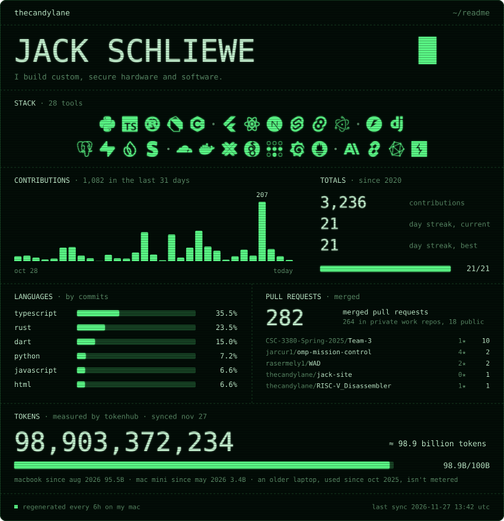

<a href="https://schliewesystems.com"></a>

My recent specialty is improving agent and human collaboration while developing secure software. Engineer at [FarmMind](https://farmmind.org), builder of [ref-radar](https://ref.lookit.space) on the side, graduating in December with a bachelor's in cybersecurity from LSU.

### `01` ref-radar · [ref.lookit.space](https://ref.lookit.space)

Prior art for coding agents. Context7 answers "how do I call this library?". ref-radar answers "who already built this, where do I start reading, and can I reuse it?" Every ref has a why line, start-here paths pinned to a commit, and a reuse verdict from its license. Over 7,600 curated refs across 358 topics, not only AI: databases, security, science, games, finance and the rest.

```sh
claude mcp add --transport http ref-radar https://ref.lookit.space/mcp
```

No install and no account for reading. The catalog is exported every night to [ref-radar-data](https://github.com/thecandylane/ref-radar-data), and anyone can suggest a ref there.

### `02` What I run

| | |
|---|---|
| **[The Bakery](https://github.com/thecandylane/thebakery)** | A desktop workspace for building software with AI agents: IDE, container manager and git client in one app. A Rust daemon owns the event log, git and every sign-in. Agents run in sandboxed rooms that never hold a real credential; the node swaps the real one in at the room's door. |
| **[tokenhub](https://github.com/thecandylane/tokenhub)** | A local proxy that logs token usage for Claude Code, Codex, Grok Build, omp, OpenRouter and Ollama to SQLite, with a macOS menu bar plugin. Headers and bodies pass through untouched, so it holds no keys. |
| **The private brain** | My agents' shared memory: notes from every project and private refs in a knowledge graph on a Mac mini, searched by BM25 and vectors fused with RRF, served over MCP to my own tailnet only. Agents search it before they investigate and write back what they learn. Not public, on purpose. |
| **[schliewesystems.com](https://schliewesystems.com)** | Next.js on Cloudflare Workers with a phosphor terminal, an agent CTF, a small JavaScript VM with planted exploit labs, and in-browser security tools. [Source](https://github.com/thecandylane/jack-site). |
| **[no-glaze](https://github.com/thecandylane/no-glaze)** | A Claude Code plugin that strips sycophancy, surfaces contradictions and refuses to confabulate. |
| **[candylane](https://github.com/thecandylane/candylane)** | Rebuilds a Windows machine from one profile, debloated and hardened, with a pull and revert engine that records an undo for every action. Rust. |
| **[RISC-V_Disassembler](https://github.com/thecandylane/RISC-V_Disassembler)** | An RV32I disassembler I wrote in C++ in 2023, finished and ported to JavaScript in 2026, checked against `llvm-mc`. [The write-up](https://schliewesystems.com/blog/reading-risc-v-by-hand). |

### `03` Security

- **Malware analysis:** Bash tooling to take apart the Shai-Hulud npm worm, which hooked the startup routines of AI coding assistants.
- **Web and API testing:** FarmMind's own apps, tested with Burp Suite, ZAP, Invicti and Wapiti.
- **Exploitation and reversing:** stack overflows, format strings and binary analysis with Ghidra and IDA Pro, in LSU coursework and CTFs.
- **Agent security:** harnesses that isolate credentials, sandbox agent rooms, and block image exfiltration when rendering markdown. [Three red-team tools against my own agent](https://schliewesystems.com/blog/three-red-team-tools-one-agent).
- **Homelab:** a multi-node environment over WireGuard, logs in Loki with alert rules based on MITRE ATT&CK, every host hardened.

<sub>[schliewesystems.com](https://schliewesystems.com) · [blog](https://schliewesystems.com/blog) · [ref.lookit.space](https://ref.lookit.space) · [linkedin](https://www.linkedin.com/in/thecandylane/) · agents: [llms.txt](https://schliewesystems.com/llms.txt)</sub>
